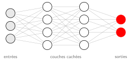
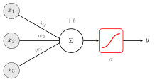
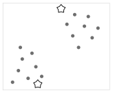
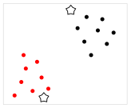
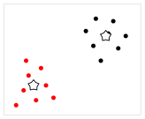

# Organisation

## Objectifs du cours

À la fin du cours, vous serez capables de :

<!-- Liste à puces : « - » ; sous-liste : indentation de 2 espaces -->

- distinguer les grandes familles de l'**IA** (symbolique, statistique, connexionniste) ;
- entraîner et évaluer un modèle d'apprentissage automatique ;
  - en particulier choisir une métrique adaptée au problème ;
- discuter des limites et des enjeux éthiques d'un système d'IA.

<!--
Deux sortes de commentaires :
- commentaire HTML (comme celui-ci) : pour l'auteur, jamais affiché ;
- ::: notes : notes de l'orateur, affichées dans la vue orateur (touche S
  pendant la présentation, qui montre aussi la diapositive suivante et un
  chronomètre), jamais dans le PDF.
-->

::: notes
Présenter les objectifs en 2 minutes ; insister sur l'évaluation des modèles,
qui sera notée au TP 3.
:::

## Apparition progressive

Qu'est-ce que l'intelligence artificielle ?

<!-- « . . . » seul sur sa ligne : pause, la suite apparaît au clic suivant -->

. . .

Un ensemble de techniques permettant à une machine d'accomplir des tâches
qui demandent habituellement de l'intelligence humaine.

<!--
Bloc « incremental » : les éléments de la liste apparaissent un par un.
Pour rendre toutes les listes progressives, ajouter `incremental: true`
sous le format dans _quarto.yml ; « ::: nonincremental » fait alors l'inverse.
-->

::: incremental
- systèmes experts (règles écrites à la main) ;
- apprentissage automatique (règles apprises à partir des données) ;
- apprentissage profond (réseaux de neurones à plusieurs couches).
:::

# Apprentissage automatique

## Image avec légende

<!--
Image : {options}. Une légende non vide est affichée sous
l'image ; `width` est relatif à la largeur de la diapositive.
Formats : SVG (vectoriel, à privilégier), PNG, JPG ; pas de PDF (non affiché
par les navigateurs).
-->

{width=80%}

<!--
Notes de l'orateur : visibles dans la vue orateur (touche S pendant la
présentation), jamais dans le PDF.
-->

::: notes
Insister sur le fait que chaque flèche porte un poids appris.
:::

## Image et texte en colonnes

<!--
Colonnes : un bloc « :::: columns » (4 deux-points) contient des blocs
« ::: {.column width="..."} » (3 deux-points). La somme des largeurs ne
doit pas dépasser 100 %. Une image sans légende () remplit la colonne.
-->

:::: columns
::: {.column width="55%"}

:::

::: {.column width="45%"}
Un **neurone artificiel** :

<!-- Liste numérotée : « 1. », « 2. », ... -->

1. pondère ses entrées $x_i$ par des poids $w_i$ ;
2. ajoute un biais $b$ ;
3. applique une fonction d'activation $\sigma$.

<!-- Formule : $...$ dans le texte, $$...$$ centrée sur sa propre ligne -->

$$
y = \sigma\Big(\sum_i w_i x_i + b\Big)
$$
:::
::::

## Texte et image en colonnes

:::: columns
::: {.column width="50%"}
L'algorithme **k-means** regroupe des points en $k$ groupes, sans étiquettes :
c'est de l'apprentissage **non supervisé**.

Les étoiles représentent les centroïdes des groupes.
:::

::: {.column width="50%"}
{width=90%}
:::
::::

## Animation d'images

<!--
Animation : « ::: r-stack » superpose les images ; les classes .fragment
font apparaître (ou disparaître) un élément au clic. fragment-index
synchronise les éléments d'une même étape :
- .fade-out : visible au départ, masqué à l'étape 1 ;
- .fade-in-then-out : visible à l'étape 1 seulement ;
- [texte]{.fragment} : texte qui apparaît à l'étape donnée.
Le PDF ne garde que l'état final de chaque diapositive (ici l'image 3).
-->

:::: columns
::: {.column width="50%"}
::: r-stack
{.fragment .fade-out fragment-index=1}

{.fragment .fade-in-then-out fragment-index=1}

{.fragment fragment-index=2}
:::
:::

::: {.column width="50%"}
1. Placer $k$ centroïdes au hasard.
2. [Affecter chaque point au centroïde le plus proche.]{.fragment fragment-index=1}
3. [Déplacer chaque centroïde au centre de son groupe.]{.fragment fragment-index=2}

[Répéter 2 et 3 jusqu'à stabilité.]{.fragment fragment-index=2}
:::
::::

::: notes
Faire deviner aux étudiants où vont se déplacer les centroïdes avant l'étape 3.
:::

# Mise en pratique

## Code source

<!--
Bloc de code : ```langage ... ``` (coloration syntaxique « github »).
Pour un code long, réduire la taille : « ## Code source {.smaller} »,
ou couper le code sur deux diapositives.
-->

```python
from sklearn.datasets import load_iris
from sklearn.model_selection import train_test_split
from sklearn.tree import DecisionTreeClassifier

X, y = load_iris(return_X_y=True)
X_train, X_test, y_train, y_test = train_test_split(X, y, test_size=0.2)

modele = DecisionTreeClassifier(max_depth=3).fit(X_train, y_train)
print(f"Exactitude : {modele.score(X_test, y_test):.2f}")
```

## Blocs

<!--
Sous une diapositive « ## », un titre « ### » crée un bloc :
bloc standard (noir), {.alert} (rouge) ou {.example} (gris).
-->

### Définition

L'**apprentissage supervisé** consiste à apprendre une fonction $f : X \to Y$
à partir d'exemples étiquetés $(x_i, y_i)$.

### Attention {.alert}

Un modèle parfait sur les données d'entraînement peut être en **surapprentissage** :
toujours évaluer sur des données de test.

### Exemple {.example}

Prédire si un courriel est un pourriel à partir de son contenu.

## Formule et tableau

:::: columns
::: {.column width="50%"}
Précision et rappel d'un classifieur :

<!-- \qquad : grand espace horizontal ; \text{...} : texte droit dans une formule -->

$$
P = \frac{\text{VP}}{\text{VP} + \text{FP}} \qquad R = \frac{\text{VP}}{\text{VP} + \text{FN}}
$$

où VP, FP et FN sont les vrais positifs, faux positifs et faux négatifs.
:::

::: {.column width="50%"}
<!--
Tableau Markdown : colonnes séparées par « | », ligne d'en-tête suivie de
tirets. Les colonnes n'ont pas besoin d'être alignées dans le source.
-->

| Algorithme          | Type           |
|---------------------|----------------|
| Régression logistique | supervisé    |
| Arbre de décision   | supervisé      |
| k-means             | non supervisé  |
| Q-learning          | par renforcement |
:::
::::

## Glossaire {.scrollable}

<!--
Contenu trop long : rien n'est coupé automatiquement, le texte qui dépasse
sort de la diapositive sans avertissement. Solutions :
- {.scrollable} : la diapositive défile (molette) pendant la présentation ;
  dans le PDF, le contenu est réduit pour tenir sur une page.
- {.smaller} : réduit la taille du texte (léger dépassement seulement).
- Sinon, couper soi-même en deux diapositives « ## ».
-->

- **Agent** : entité qui perçoit son environnement et agit pour atteindre un but.
- **Apprentissage supervisé** : apprentissage à partir d'exemples étiquetés.
- **Apprentissage non supervisé** : recherche de structure dans des données sans étiquettes.
- **Apprentissage par renforcement** : apprentissage par essais et récompenses.
- **Biais** : terme constant d'un neurone ; aussi, erreur systématique d'un modèle.
- **Centroïde** : centre d'un groupe de points (k-means).
- **Classification** : prédiction d'une catégorie.
- **Descente de gradient** : méthode d'optimisation itérative des paramètres.
- **Époque** : un passage complet sur les données d'entraînement.
- **Fonction de perte** : mesure de l'erreur du modèle à minimiser.
- **Hyperparamètre** : réglage fixé avant l'entraînement (profondeur, taux d'apprentissage...).
- **Jeu de test** : données réservées à l'évaluation finale du modèle.
- **Régression** : prédiction d'une valeur numérique.
- **Surapprentissage** : modèle trop ajusté aux données d'entraînement.
- **Validation croisée** : évaluation sur plusieurs découpages des données.

## Corrigé de l'exercice {visibility="hidden"}

<!--
Diapositive cachée : {visibility="hidden"} la retire de la présentation et
du PDF (elle n'est même pas écrite dans le .html), sans la supprimer du .qmd :
pratique pour un corrigé à montrer plus tard, ou une diapositive en cours de
rédaction. Retirer l'attribut pour l'afficher à nouveau.
{visibility="uncounted"} l'affiche, mais sans la numéroter (annexes).
-->

Le modèle obtient une exactitude d'environ 0.95 sur le jeu de test.

## Questions ?

Merci de votre attention.
